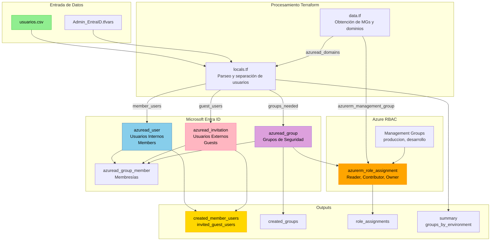
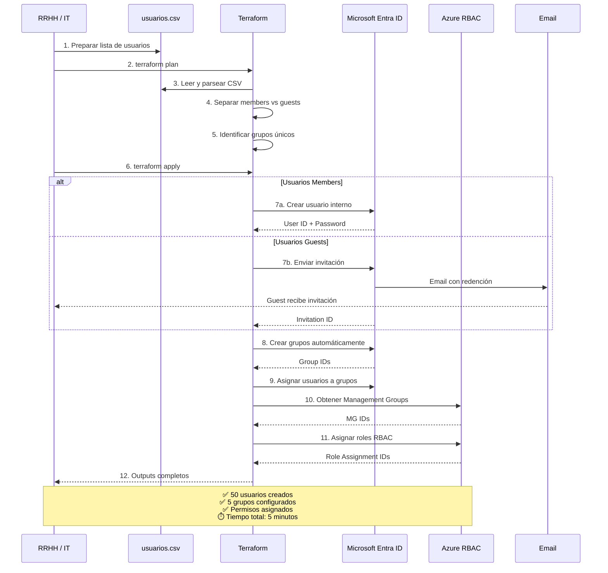

¿Has tenido que crear 50 usuarios nuevos en Azure AD manualmente? ¿Asignar cada uno a su grupo correspondiente? ¿Configurar permisos RBAC uno por uno? Si tu respuesta es sí, sabrás que es un proceso tedioso, propenso a errores y que consume horas de trabajo.

Hoy te voy a mostrar cómo **automaticé completamente este proceso** usando Terraform, reduciendo el onboarding de 50 empleados de **4 horas a solo 5 minutos**.

## El Problema: Gestión Manual de Identidades

En mi experiencia trabajando con equipos de IT, he visto el mismo problema repetirse una y otra vez:

### Proceso Manual Tradicional

```
📋 Recibir lista de nuevos empleados en Excel
    ↓
🖱️ Abrir portal de Azure
    ↓
👤 Crear usuario 1 manualmente
    ↓
🔐 Generar contraseña temporal
    ↓
📝 Copiar contraseña a documento Word
    ↓
👥 Buscar y asignar grupos
    ↓
🔑 Configurar permisos RBAC
    ↓
✉️ Enviar email con credenciales
    ↓
🔄 Repetir 49 veces más...
```

**Resultado**: 
- ⏰ 4-5 horas de trabajo manual
- ❌ Errores de transcripción
- 🔓 Inconsistencias en permisos
- 📧 Contraseñas enviadas por email inseguro
- 😫 Frustración del equipo de IT

## La Solución: CSV + Terraform = Automatización Total

Desarrollé una solución que transforma un simple archivo CSV en una infraestructura completa de identidades en Microsoft Entra ID (antes Azure AD).

### ¿Qué Logra Esta Solución?

✅ **Crear usuarios internos** (members) con perfiles completos  
✅ **Invitar usuarios externos** (guests) automáticamente  
✅ **Generar grupos** dinámicamente desde el CSV  
✅ **Asignar membresías** automáticamente  
✅ **Configurar RBAC** a nivel de Management Group por entorno  
✅ **Gestionar contraseñas** de forma segura  
✅ **Outputs detallados** con toda la información necesaria  

## Arquitectura de la Solución

La solución utiliza Terraform con los providers `azuread` y `azurerm` para orquestar todo el proceso:



## El Formato del CSV: Simplicidad y Potencia

El corazón de la solución es un archivo CSV con 14 columnas que definen todo lo necesario para cada usuario:

```csv
user_principal_name,nombre_completo,nombre,apellido,departamento,puesto,grupo,password,habilitado,location,sku_id,rol_azure,tipo_usuario,entorno
juan.perez@empresa.com,Juan Pérez,Juan,Pérez,IT,Administrador,Admins-Prod,Pass123!,true,ES,,Owner,member,produccion
maria.lopez@empresa.com,María López,María,López,Dev,Developer,Devs-Dev,,true,ES,,Contributor,member,desarrollo
consultor@gmail.com,Pedro Consultor,Pedro,Consultor,Externo,Consultor,Consultores,,true,ES,,Reader,guest,produccion
```

### Columnas Clave

| Columna | Descripción | Ejemplo |
|---------|-------------|---------|
| `user_principal_name` | Email del usuario | `usuario@empresa.com` |
| `tipo_usuario` | `member` o `guest` | Define si es interno o externo |
| `grupo` | Nombre del grupo (se crea si no existe) | `Developers` |
| `rol_azure` | Rol RBAC | `Reader`, `Contributor`, `Owner` |
| `entorno` | Entorno objetivo | `produccion`, `desarrollo` |
| `password` | Contraseña personalizada (opcional) | `SecurePass123!` |

## Implementación Paso a Paso

### Paso 1: Preparar el CSV

El equipo de RRHH o IT prepara el archivo CSV con los nuevos empleados:

```csv
user_principal_name,nombre_completo,nombre,apellido,departamento,puesto,grupo,password,habilitado,location,sku_id,rol_azure,tipo_usuario,entorno
nuevo.empleado01@empresa.com,Empleado Uno,Empleado,Uno,IT,Junior Dev,Developers,,true,ES,,Reader,member,desarrollo
nuevo.empleado02@empresa.com,Empleado Dos,Empleado,Dos,IT,Senior Dev,Developers,,true,ES,,Contributor,member,desarrollo
nuevo.empleado03@empresa.com,Empleado Tres,Empleado,Tres,Marketing,Specialist,Marketing,,true,ES,,Reader,member,produccion
```

### Paso 2: Configurar Variables

En `Admin_EntraID.tfvars`:

```hcl
# Contraseña por defecto
default_password = "TemporalSecure2024!"

# Forzar cambio de contraseña
force_password_change = true

# Crear grupos automáticamente
create_groups_if_not_exist = true

# Asignar roles a Management Groups
assign_roles_to_management_group = true

# Mapeo de entornos a Management Groups
environment_config = {
  produccion = {
    management_group_id = "mg-prod"
  }
  desarrollo = {
    management_group_id = "mg-dev"
  }
}
```

### Paso 3: Ejecutar Terraform

```bash
# Inicializar
terraform init

# Revisar cambios
terraform plan -var-file="Admin_EntraID.tfvars"

# Aplicar
terraform apply -var-file="Admin_EntraID.tfvars"
```

### Paso 4: Obtener Resultados

Terraform devuelve outputs organizados:

```bash
# Resumen general
terraform output summary
# Output:
# {
#   "total_member_users_created": 50,
#   "total_guest_users_invited": 3,
#   "total_groups_created": 5,
#   "domain": "empresa.onmicrosoft.com"
# }

# Ver usuarios creados
terraform output created_member_users

# Ver grupos y asignaciones
terraform output role_assignments
```

## Flujo de Trabajo Completo



## Casos de Uso Reales

### Caso 1: Onboarding Masivo (50 Empleados)

**Escenario**: Una empresa contrata 50 desarrolladores para un nuevo proyecto.

**Antes (Manual)**:
- ⏰ Tiempo: 4-5 horas
- ❌ Errores: 5-10 usuarios con permisos incorrectos
- 😫 Frustración: Alta

**Después (Automatizado)**:
- ⏰ Tiempo: 5 minutos
- ✅ Errores: 0 (todo validado por Terraform)
- 😊 Satisfacción: Alta

**CSV de ejemplo**:
```csv
user_principal_name,nombre_completo,nombre,apellido,departamento,puesto,grupo,password,habilitado,location,sku_id,rol_azure,tipo_usuario,entorno
dev01@empresa.com,Dev Uno,Dev,Uno,Desarrollo,Junior,Developers,,true,ES,,Reader,member,desarrollo
dev02@empresa.com,Dev Dos,Dev,Dos,Desarrollo,Junior,Developers,,true,ES,,Reader,member,desarrollo
...
dev50@empresa.com,Dev Cincuenta,Dev,Cincuenta,Desarrollo,Junior,Developers,,true,ES,,Reader,member,desarrollo
```

**Comando**:
```bash
terraform apply -var-file="Admin_EntraID.tfvars" -auto-approve
```

**Resultado**: 50 usuarios creados, asignados al grupo "Developers", con rol "Reader" en el Management Group de desarrollo.

### Caso 2: Consultores Externos Temporales

**Escenario**: 10 consultores externos necesitan acceso limitado durante 3 meses.

```csv
user_principal_name,nombre_completo,nombre,apellido,departamento,puesto,grupo,password,habilitado,location,sku_id,rol_azure,tipo_usuario,entorno
consultor1@external.com,Consultor Uno,Consultor,Uno,Consultoría,Senior,Consultores-Externos,,true,ES,,Reader,guest,produccion
consultor2@external.com,Consultor Dos,Consultor,Dos,Consultoría,Senior,Consultores-Externos,,true,US,,Reader,guest,produccion
```

**Ventajas**:
- 📧 Invitaciones automáticas por email
- 🔒 Acceso limitado (solo Reader)
- ⏰ Fácil de eliminar al finalizar contrato
- 📊 Trazabilidad completa

### Caso 3: Estructura Organizacional Compleja

**Escenario**: Empresa con múltiples departamentos y niveles de acceso.

```csv
user_principal_name,nombre_completo,nombre,apellido,departamento,puesto,grupo,password,habilitado,location,sku_id,rol_azure,tipo_usuario,entorno
cto@empresa.com,CTO Principal,CTO,Principal,Dirección,CTO,IT-Leadership,SecurePass1!,true,ES,,Owner,member,produccion
arquitecto@empresa.com,Arquitecto Senior,Arquitecto,Senior,Arquitectura,Architect,Arquitectos,,true,ES,,Contributor,member,produccion
dev-senior@empresa.com,Dev Senior,Dev,Senior,Desarrollo,Senior Dev,Developers-Senior,,true,ES,,Contributor,member,desarrollo
dev-junior@empresa.com,Dev Junior,Dev,Junior,Desarrollo,Junior Dev,Developers-Junior,,true,ES,,Reader,member,desarrollo
ops@empresa.com,Ops Engineer,Ops,Engineer,Operaciones,SRE,Operations,,true,ES,,Contributor,member,produccion
```

**Jerarquía automática**:
- 👔 **IT-Leadership** → Owner en producción
- 🏗️ **Arquitectos** → Contributor en producción  
- 💻 **Developers-Senior** → Contributor en desarrollo
- 🎓 **Developers-Junior** → Reader en desarrollo
- ⚙️ **Operations** → Contributor en producción

## Características Técnicas Avanzadas

### 1. Separación Automática de Usuarios

El código Terraform separa automáticamente usuarios internos y externos:

```hcl
locals {
  users_csv = csvdecode(file("${path.module}/usuarios.csv"))
  
  # Usuarios internos (members)
  member_users = {
    for user in local.users_csv : user.user_principal_name => user
    if try(user.tipo_usuario, "member") == "member"
  }
  
  # Usuarios externos (guests)
  guest_users = {
    for user in local.users_csv : user.user_principal_name => user
    if try(user.tipo_usuario, "member") == "guest"
  }
}
```

### 2. Creación Dinámica de Grupos

Los grupos se crean automáticamente según lo que aparece en el CSV:

```hcl
resource "azuread_group" "auto_groups" {
  for_each = var.create_groups_if_not_exist ? toset(distinct([
    for user in local.users_csv : user.grupo if user.grupo != ""
  ])) : toset([])
  
  display_name     = each.value
  security_enabled = true
  mail_enabled     = false
  
  description = "Grupo creado automáticamente por Terraform"
}
```

### 3. RBAC por Entorno

Los roles se asignan automáticamente según el entorno definido en el CSV:

```hcl
resource "azurerm_role_assignment" "group_mg_roles" {
  for_each = var.assign_roles_to_management_group ? {
    for group_name, config in local.group_config : group_name => config
    if config.management_group_id != ""
  } : {}

  scope                = data.azurerm_management_group.mgs[each.value.management_group_id].id
  role_definition_name = each.value.role
  principal_id         = azuread_group.auto_groups[each.key].object_id
}
```

### 4. Gestión Segura de Contraseñas

Las contraseñas se gestionan de forma segura:

```hcl
resource "azuread_user" "member_users" {
  for_each = local.member_users
  
  # Contraseña del CSV o por defecto
  password = each.value.password != "" ? each.value.password : var.default_password
  
  # Forzar cambio en primer login
  force_password_change = var.force_password_change
}

# Output sensible
output "user_passwords" {
  value     = { for upn, user in local.member_users : upn => user.password }
  sensitive = true
}
```

## Seguridad y Mejores Prácticas

### 1. No Hardcodear Contraseñas

**❌ Mal:**
```hcl
variable "default_password" {
  default = "Password123!"
}
```

**✅ Bien:**
```bash
# Variables de entorno
export TF_VAR_default_password="$(openssl rand -base64 32)"

# O Azure Key Vault
data "azurerm_key_vault_secret" "default_password" {
  name         = "default-user-password"
  key_vault_id = data.azurerm_key_vault.main.id
}
```

### 2. Backend Remoto para el State

```hcl
terraform {
  backend "azurerm" {
    resource_group_name  = "rg-terraform-state"
    storage_account_name = "sttfstate"
    container_name       = "tfstate"
    key                  = "entraid-admin.tfstate"
  }
}
```

### 3. Principio de Mínimo Privilegio

- ✅ Asignar Reader por defecto
- ✅ Contributor solo cuando es necesario
- ✅ Owner solo para líderes técnicos
- ✅ Revisar periódicamente las asignaciones

### 4. Auditoría Continua

```bash
# Ver grupos sin Management Group configurado
terraform output groups_without_mg

# Ver distribución de grupos por entorno
terraform output groups_by_environment

# Ver todas las asignaciones de roles
terraform output role_assignments
```

## Operaciones del Día a Día

### Añadir Nuevos Usuarios

1. Editar `usuarios.csv` y añadir líneas
2. `terraform plan` para revisar
3. `terraform apply` para crear

### Modificar Permisos de un Usuario

1. Cambiar `rol_azure` o `entorno` en el CSV
2. `terraform apply`

### Deshabilitar Usuario Temporalmente

Cambiar `habilitado` a `false`:

```csv
usuario@empresa.com,Usuario Prueba,Usuario,Prueba,IT,Dev,Grupo1,,false,ES,,Reader,member,desarrollo
```

### Eliminar Usuarios

1. Eliminar línea del CSV
2. `terraform apply` (eliminará el usuario)

**⚠️ PRECAUCIÓN**: Esto eliminará permanentemente el usuario.

## Integración con CI/CD

### GitHub Actions

```yaml
name: Deploy Entra ID Users

on:
  push:
    branches: [main]
    paths:
      - 'usuarios.csv'

jobs:
  terraform:
    runs-on: ubuntu-latest
    steps:
      - uses: actions/checkout@v3
      
      - name: Setup Terraform
        uses: hashicorp/setup-terraform@v2
        
      - name: Azure Login
        uses: azure/login@v1
        with:
          creds: ${{ secrets.AZURE_CREDENTIALS }}
      
      - name: Terraform Apply
        run: |
          terraform init
          terraform plan -var-file="Admin_EntraID.tfvars"
          terraform apply -auto-approve -var-file="Admin_EntraID.tfvars"
```

**Flujo automático**:
1. RRHH actualiza `usuarios.csv` en GitHub
2. Commit + Push
3. GitHub Actions ejecuta Terraform automáticamente
4. Usuarios creados en minutos

## ROI: Tiempo es Dinero

Comparemos el ROI de esta solución:

### Escenario: 50 Usuarios Nuevos/Mes

**Método Manual**:
- ⏰ Tiempo: 5 horas (6 min/usuario)
- 💰 Costo: €150 (€30/hora × 5 horas)
- ❌ Errores: 5-10 usuarios con permisos incorrectos
- 🔄 Tiempo corrección: 2 horas adicionales (€60)
- **Total mensual**: €210

**Método Automatizado**:
- ⏰ Tiempo: 15 minutos (preparar CSV + ejecutar)
- 💰 Costo: €7.50 (€30/hora × 0.25 horas)
- ✅ Errores: 0
- 🔄 Tiempo corrección: 0
- **Total mensual**: €7.50

**Ahorro mensual**: €202.50  
**Ahorro anual**: €2,430  
**ROI**: Recuperas la inversión en desarrollo en el primer mes

### Beneficios Adicionales (No Monetizables)

- 😊 **Satisfacción del equipo**: Menos trabajo tedioso
- 🎯 **Consistencia**: Todos los usuarios siguen el mismo patrón
- 📊 **Auditoría**: Trazabilidad completa de cambios
- 🔒 **Seguridad**: Menos errores = menos brechas de seguridad
- 📈 **Escalabilidad**: 50 o 500 usuarios, el tiempo es el mismo

## Lecciones Aprendidas

### 1. Empezar con un CSV Simple

No intentes incluir todas las columnas desde el principio. Empieza con lo básico:
- user_principal_name
- nombre_completo
- grupo
- tipo_usuario

Añade complejidad gradualmente.

### 2. Validar el CSV Antes de Aplicar

Crea un script de validación:

```bash
#!/bin/bash
# validate-csv.sh

# Verificar que todos los emails sean válidos
awk -F',' 'NR>1 {print $1}' usuarios.csv | while read email; do
  if ! echo "$email" | grep -E '^[a-zA-Z0-9._%+-]+@[a-zA-Z0-9.-]+\.[a-zA-Z]{2,}$' > /dev/null; then
    echo "❌ Email inválido: $email"
    exit 1
  fi
done

echo "✅ CSV válido"
```

### 3. Testear en Desarrollo Primero

Siempre prueba en un tenant de desarrollo antes de producción:

```bash
# Desarrollo
terraform workspace select dev
terraform apply -var-file="Admin_EntraID.tfvars"

# Producción (solo después de validar)
terraform workspace select prod
terraform apply -var-file="Admin_EntraID.tfvars"
```

### 4. Documentar Todo

Mantén un log de cambios:

```bash
# changelog.md
## 2026-01-22
- Añadidos 50 nuevos desarrolladores
- Creado grupo "Developers-Team-Alpha"
- Asignado rol Contributor en mg-dev

## 2026-01-15
- Invitados 5 consultores externos
- Creado grupo "Consultores-Q1-2026"
- Asignado rol Reader en mg-prod
```

## Troubleshooting Común

### Error: "User already exists"

**Solución**: Importar el usuario existente

```bash
USER_ID=$(az ad user show --id usuario@empresa.com --query id -o tsv)
terraform import 'azuread_user.member_users["usuario@empresa.com"]' $USER_ID
```

### Error: "Insufficient privileges"

**Solución**: Verificar roles del Service Principal

```bash
# Ver roles actuales
az role assignment list --assignee <sp-id>

# Asignar rol necesario
az role assignment create \
  --assignee <sp-id> \
  --role "User Administrator" \
  --scope "/providers/Microsoft.Management/managementGroups/<mg-id>"
```

### Error: "Management Group not found"

**Solución**: Verificar que el MG existe y es accesible

```bash
# Listar MGs disponibles
az account management-group list --query "[].{Name:name, DisplayName:displayName}"

# Verificar acceso
az account management-group show --name <mg-name>
```

## Próximos Pasos y Mejoras

Actualmente estoy trabajando en las siguientes mejoras:

- [ ] **Integración con Active Directory on-premises** vía Azure AD Connect
- [ ] **Asignación automática de licencias** (M365, Azure, etc.)
- [ ] **Rotación automática de contraseñas** cada X días
- [ ] **Notificaciones a Slack/Teams** cuando se crean usuarios
- [ ] **Dashboard de auditoría** con Power BI
- [ ] **API REST** para integración con sistemas RRHH
- [ ] **Validación pre-apply** más robusta del CSV

## Conclusión

Esta solución ha transformado completamente cómo gestionamos identidades en Microsoft Entra ID:

**Antes**:
- ⏰ 4-5 horas para 50 usuarios
- ❌ 10-15% de error
- 😫 Proceso tedioso y frustrante
- 🔓 Inconsistencias de seguridad

**Después**:
- ⚡ 5 minutos para 50 usuarios
- ✅ 0% de error
- 😊 Proceso automatizado y confiable
- 🔒 Seguridad consistente

**Beneficios clave**:
- 💰 Ahorro de €2,430/año
- ⚡ 98% reducción de tiempo
- 🎯 100% consistencia
- 📊 Trazabilidad completa
- 🔄 Totalmente reproducible

Si tu equipo está gestionando usuarios manualmente en Azure AD, esta solución puede cambiar radicalmente tu forma de trabajar.

### ¿Quieres implementarlo?

El código completo está disponible en mi repositorio de GitHub:

- [github.com](https://github.com/luisadanmunoz/Admin_EntraID-Create_User_members_-_guests_Groups_RBAC_management_group_CSV)

Si tienes preguntas o mejoras, no dudes en abrir un issue en el repositorio o contactarme directamente.

---

## Recursos Adicionales

- [Documentación Microsoft Entra ID](https://learn.microsoft.com/en-us/entra/fundamentals/)
- [Terraform AzureAD Provider](https://registry.terraform.io/providers/hashicorp/azuread/latest/docs)
- [Azure RBAC Best Practices](https://learn.microsoft.com/en-us/azure/role-based-access-control/best-practices)
- [Mi blog técnico](https://luisadanmunoz.github.io/)

**Tags**: `#Azure` `#Terraform` `#EntraID` `#AzureAD` `#InfrastructureAsCode` `#Automation` `#DevOps` `#IdentityManagement` `#RBAC` `#CloudSecurity` `#CloudAutomation`

---

*¿Te ha resultado útil este artículo? Compártelo con tu equipo y ayúdales a automatizar su gestión de identidades.*
