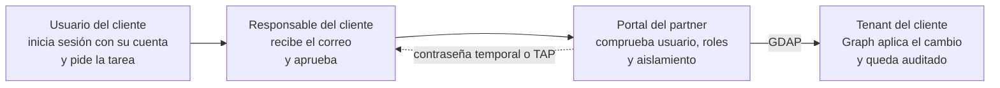

Trabajo en un partner CSP de Microsoft y hay dos quejas que se repiten en casi todos los clientes: **"no veo lo que me cuesta Azure"** y **"para resetear una contraseña tengo que abrir un ticket y esperar"**. Las dos tienen solución con herramientas que Microsoft ya da a los partners, pero nadie las había juntado.

Empecé queriendo tener el rol de administrador en Microsoft 365 Lighthouse y acabé con un portal de autoservicio en el que el usuario del cliente pide la tarea, su responsable la aprueba con un clic desde el correo y la tarea se ejecuta sola en el tenant del cliente vía GDAP.

Esta es la historia de cómo llegué hasta ahí, con las decisiones, los callejones sin salida y los errores que me encontré por el camino.

---

## La regla que me impuse: solo lectura hasta entender lo que hay

Antes de tocar nada en un entorno con decenas de clientes, todo lo que hice durante los primeros días fue **de solo lectura**: auditar, sondear APIs y medir. Solo cuando entendí el modelo de permisos pasé a escribir, y siempre primero en un tenant de laboratorio.

Y toda afirmación técnica, contrastada con Microsoft Learn. Para eso conecté el MCP oficial de Microsoft Learn a Claude y le pedí que cada respuesta viniera con su fuente. Varias veces me salvó de dar por buena una suposición.

---

## Fase 0: dos capas de permisos que se confunden

Lo primero que aprendí es que en Lighthouse hay **dos capas de permisos independientes**, y casi todo el mundo las mezcla:

| Capa | Dónde vive | Qué controla |
|---|---|---|
| **RBAC de Lighthouse** | Tenant del partner | Qué puedes ver y hacer *dentro de Lighthouse*: alertas, baselines, etiquetas, Sales Advisor |
| **GDAP** | Tenant de cada cliente | Roles de Entra ID delegados que dan acceso real a los datos y la configuración del cliente |

El rol RBAC de Lighthouse **no da acceso a los datos del cliente**. Si un técnico "no puede hacer X" sobre un cliente, casi siempre falta un rol en la relación GDAP o la pertenencia a un grupo, no un rol de Lighthouse.

Dos detalles que conviene saber antes de pedir permisos:

- El rol **Administrador** de Lighthouse concede automáticamente Administrador de roles con privilegios, Administrador de usuarios y Administrador de grupos en Entra ID, y Admin Agent en Partner Center. No es un rol para repartir a la ligera.
- Solo se puede asignar a un **grupo con asignación de roles** (requiere Entra ID P1). Cuando me ofrecieron reutilizar grupos existentes, resultó que eran de *Azure* Lighthouse, otro producto distinto. Usar uno de ellos habría dado control de GDAP sobre todos los clientes a gente que solo gestionaba Azure Arc. Creamos un grupo dedicado.

---

## Fase 1: auditar lo que ya existe

Con el rol asignado, lo primero fue saber qué había. Escribí un script de PowerShell de **solo lectura** que vuelca a CSV las relaciones GDAP, sus asignaciones a grupos con los miembros de cada grupo, los tenants que ve Lighthouse y la directiva de costes de cada cliente:

```powershell
Connect-MgGraph -TenantId $partnerTenantId -NoWelcome -Scopes @(
  'DelegatedAdminRelationship.Read.All', 'ManagedTenants.Read.All',
  'GroupMember.Read.All', 'RoleManagement.Read.Directory')

$rels = (Invoke-MgGraphRequest GET `
  "https://graph.microsoft.com/v1.0/tenantRelationships/delegatedAdminRelationships" -OutputType PSObject).value
```

Lo que conviene buscar en una auditoría así:

- **Global Administrator permanente.** Microsoft desaconseja sustituir GA por la suma de todos los roles, y además **una relación con GA no admite auto-extensión**: caduca y hay que volver a pedir la aprobación del cliente.
- **Segregación de funciones.** Si los grupos de soporte y de administración tienen exactamente los mismos roles, en la práctica no hay segregación.
- **Caducidades próximas** y relaciones activas sin ningún grupo asignado (que nadie puede usar).
- **Solicitudes pendientes:** caducan a los 90 días si el cliente no las aprueba.

La conclusión fue incómoda pero útil: antes de vender un servicio basado en accesos delegados, hay que **ordenar los propios accesos**. No se puede ofrecer un informe de transparencia de accesos al cliente con un modelo de permisos desordenado.

---

## Fase 2: la visibilidad de costes, que era lo más fácil

Esta era la queja comercial más repetida. Resulta que un partner puede activar, cliente a cliente, una directiva que permite al cliente ver **Cost Management en su propio tenant**. Está en el portal de Azure, en la cuenta Microsoft Partner Agreement, en *Clientes > cliente > Directivas*, y también por API:

```powershell
$body = @{ properties = @{ viewCharges = "Allowed" } } | ConvertTo-Json
Invoke-AzRestMethod -Method PUT `
  -Path "/providers/Microsoft.Billing/billingAccounts/$ba/customers/$customer/policies/default?api-version=2020-05-01" `
  -Payload $body
```

Con trampa: el cliente ve los costes **a precio de lista (PAYG)**, sin descuentos ni créditos del partner, y el uso de reservas aparece a coste cero. La función de *markup* de Cost Management solo existe para EA indirectos y para Azure operado por 21Vianet, no para CSP.

Para enseñar al cliente su precio real hay que exportar los costes desde el tenant del partner y aplicar el precio en un informe propio. Aun así, activar la directiva ya resuelve buena parte de la queja.

Dos tropiezos de portal que me hicieron perder tiempo:

- La entrada *Clientes* solo aparece en la cuenta de tipo **Microsoft Partner Agreement**. En mi lista había dos cuentas con el mismo nombre, una MPA y otra MCA, y estaba entrando en la que no era.
- Para cambiar la directiva hay que ser **Admin Agent**. Ver la cuenta como administrador global no basta.

---

## Fase 3: qué se puede hacer de verdad con Lighthouse por API

Lighthouse tiene una API en Microsoft Graph (`/beta/tenantRelationships/managedTenants`), pero está en beta y **solo admite permisos delegados**. En lugar de fiarme de la documentación, escribí un sondeo que llama a cada colección y anota qué responde:

| Colección | Resultado |
|---|---|
| `tenants`, `myRoles`, `tenantsDetailedInformation` | ✅ Funcionan |
| `credentialUserRegistrationsSummaries`, `conditionalAccessPolicyCoverages` | ✅ Funcionan |
| Cumplimiento de dispositivos, malware, protección de Windows | ✅ Funcionan |
| `managementTemplates` | ✅ Solo el catálogo |
| `managementIntents`, `managementActions`, sus estados de despliegue | ❌ 404 |
| `tenantGroups` | ❌ 404 |

Conclusión: por API, Lighthouse sirve para **leer la postura de seguridad**, no para aplicar configuraciones. Las baselines se despliegan desde el portal.

Además, Lighthouse solo gestiona por completo los tenants que cumplen sus requisitos: GDAP, al menos una suscripción de Microsoft 365 o similar, **hasta 2.500 usuarios con licencia** y misma región que el partner. El resto se queda en una experiencia limitada. En mi caso, la mayoría de tenants no eran aptos, y los de laboratorio tampoco, porque no tenían licencias de M365.

Y dos matices al leer los datos de MFA:

- El informe de registro de MFA **requiere Entra ID P1** en el cliente. Un tenant Free que aparece con cero registros no significa que no tenga MFA: significa que **no hay datos**.
- El indicador de Lighthouse solo mira acceso condicional y *security defaults*. **No detecta el MFA por usuario** (el método heredado), que sí funciona sin licencia y se puede leer en Graph con `perUserMfaState`.

---

## Fase 4: Graph con GDAP desde mi propia app

El siguiente paso era actuar, no solo leer. Mi primera prueba con *Microsoft Graph Command Line Tools* contra un tenant cliente falló. La razón: con GDAP, la app que usa el técnico tiene que estar **autorizada en el tenant del cliente**.

La solución fue registrar en el tenant del partner una **app multi-tenant, cliente público, solo con permisos delegados**. La app no puede hacer nada por sí misma: todo queda limitado a los roles GDAP del técnico que inicia sesión.

```powershell
$appId = az ad app create --display-name "app-l0agent-gdap-cli" `
  --sign-in-audience AzureADMultipleOrgs `
  --public-client-redirect-uris http://localhost `
  --is-fallback-public-client true --query appId -o tsv
```

La app se consiente en cada cliente. En el laboratorio lo hice con la URL de *admin consent* y la cuenta de administrador del tenant; con clientes reales se hace con la API de consentimiento de Partner Center.

Y aquí el primer aprendizaje importante: **cada permiso nuevo exige volver a consentir la app en cada cliente**. Si no, aparece este error al iniciar sesión:

```
AADSTS90099: The application '<app-id>' has not been authorized in the tenant '<tenant-id>'.
Applications must be authorized to access the customer tenant before partner delegated administrators can use them.
```

Un técnico vía GDAP no puede conceder el consentimiento al vuelo como haría un usuario normal. Por eso conviene definir desde el principio el conjunto de permisos del catálogo completo.

Con la app consentida, el patrón es sencillo: me conecto con mi cuenta del partner, pero apuntando al tenant del cliente:

```powershell
Connect-MgGraph -ClientId $appId -TenantId $customerTenantId -Scopes "User.Read.All"
Get-MgContext | Select-Object Account, TenantId   # mi cuenta del partner, en el tenant del cliente
```

---

## Fase 5: las primeras tareas reales

### Cambio de contraseña

La más sencilla: un `PATCH` sobre el usuario con `passwordProfile` y `forceChangePasswordNextSignIn`. Funcionó a la primera, y en los registros de auditoría del cliente aparece mi cuenta del partner como autora del cambio.

### Móvil nuevo: reseteo de MFA

Es uno de los tickets más habituales. El flujo que buscaba: borrar los métodos MFA antiguos, emitir un **Temporary Access Pass (TAP)** de un solo uso y cerrar las sesiones, para que el usuario registre Authenticator en el móvil nuevo.

La primera ejecución falló con este error:

```
Cannot delete default method with other methods configured. Please change default method before deletion.
```

La API **no deja borrar el método predeterminado mientras queden otros**. La solución fue borrar en varias pasadas: primero lo que se puede, y el predeterminado al final, cuando ya es el último.

```powershell
for ($pass = 1; $pass -le 4; $pass++) {
  Start-Sleep -Seconds 5   # margen para la replicación
  $pending = @(Get-AuthMethods | Where-Object { $segment.ContainsKey($_.Tipo) })
  if ($pending.Count -eq 0) { break }
  foreach ($m in $pending) {
    try   { Invoke-MgGraphRequest DELETE "$base/$($segment[$m.Tipo])/$($m.id)" -ErrorAction Stop | Out-Null }
    catch { }   # 400: es el predeterminado, siguiente pasada · 404: ya borrado
  }
}
```

Esa misma prueba destapó otro comportamiento: **la consistencia eventual**. Un teléfono recién añadido no aparecía en el siguiente listado, y un método recién borrado seguía apareciendo unos segundos después. Cualquier automatización tiene que reintentar y **verificar el estado final**, no fiarse de la primera respuesta, y distinguir un 404 (ya hecho) de un 400 (regla de negocio).

---

## Fase 6: de ejecutar tareas a autorremediar

Con las piezas probadas, cambié el enfoque: no solo atender lo que pide el usuario, sino **detectar la necesidad del cliente y corregirla sola**. Monté un pequeño motor de reglas, cada una con el ciclo *detectar → remediar → verificar → dejar evidencia*:

| Regla | Necesidad del cliente | Acción |
|---|---|---|
| Bajas | RR. HH. mete a un usuario en el grupo de bajas | Corrige sola: bloquea, cierra sesiones, borra MFA |
| Contraseñas | Cuentas con contraseña que nunca caduca | Corrige sola |
| MFA | Usuarios sin ningún método MFA | Informa |
| Privilegiados | Administradores sin MFA o exceso de Global Admin | Informa y pide aprobación |
| Aplicaciones | Secretos o certificados a punto de caducar | Informa con antelación |

Con modo informe, simulación (`-WhatIf`) y remediación, y tres salvaguardas que no se saltan nunca: **no actuar sobre usuarios con roles de administrador, ni sobre un grupo de exclusión, ni sobre usuarios sincronizados desde AD local** (su contraseña vive en el AD, no en la nube).

---

## Fase 7: el portal para el cliente

Lo que buscaba al final era que el cliente pudiera pedirlo **sin abrir un ticket**. La primera versión del portal tenía un fallo de concepto: todo ocurría con identidades del partner. Yo pedía, yo aprobaba y yo ejecutaba. Al enseñárselo a mi jefe la pregunta fue obvia: *"¿y el cliente dónde está?"*.

La versión buena separa tres identidades:



- **El cliente pide y aprueba con su propia cuenta**, mediante una segunda app que solo tiene `User.Read`. Nunca toca la app que ejecuta.
- **El partner ejecuta** con su identidad GDAP. En la demo, mi sesión iniciada una vez al arrancar; en producción, una cuenta de servicio con su propio grupo GDAP de roles mínimos y su token protegido en Key Vault, que es el patrón que Microsoft documenta para aplicaciones de partners.
- **Los responsables se eligen según el usuario afectado**: lista explícita para ese usuario, después su departamento, después su manager en Entra ID y, si no hay ninguno, los responsables por defecto. Se avisa a todos y basta con que apruebe uno.

Y las reglas de seguridad que considero no negociables:

- **El cliente se deduce del tenant de quien inicia sesión**, nunca de un desplegable. Un usuario solo puede pedir tareas sobre usuarios de su propia organización.
- **Solo entran los tenants dados de alta**: una app multi-tenant admite, en principio, cualquier cuenta de Entra ID.
- **Nadie aprueba su propia solicitud** ni una que le afecte.
- **El enlace del correo no aprueba nada por sí mismo**: abre una página de revisión con los botones. Así los escáneres de enlaces del correo no pueden aprobar solicitudes al abrir el mensaje.
- **La contraseña temporal o el TAP solo llegan al responsable que aprueba.** No se guardan ni se muestran en pantalla.

El resultado: la usuaria pide el cambio de contraseña, al responsable le llega el correo, lo aprueba, recibe la contraseña temporal y, cuando la usuaria entra, Entra ID le obliga a cambiarla. Con el reseteo de MFA, recibe el TAP y registra Authenticator en el móvil nuevo. Todo sin que intervenga un técnico.

---

## Lo que aprendí por el camino

Los errores, otra vez, fueron lo más instructivo:

1. **Un token obtenido de la caché no trae los datos de identidad.** Al aprobar, MSAL reutilizaba la sesión anterior sin `id_token_claims`, el portal no sabía quién era el aprobador y lo rechazaba. La identidad hay que tomarla de la cuenta en caché.
2. **`127.0.0.1` y `localhost` no son lo mismo para el navegador.** Flask anuncia una dirección, Entra ID devuelve el inicio de sesión a la otra, la cookie de sesión no viaja y el login falla con un 400. Ahora el portal fuerza siempre la misma dirección.
3. **Un ID de ejemplo en la configuración** (`<APP_ID_DEL_FRONT>`) produce un `AADSTS90013` poco descriptivo. Validar la configuración al arrancar ahorra tiempo.
4. **La demo se rompe si la usuaria y el responsable usan la misma ventana.** El portal ve a la usuaria intentando aprobar y, con razón, la rechaza. Añadí un botón de "Cambiar de cuenta" y, en las demos, siempre ventanas privadas distintas.
5. **Un tenant de laboratorio sin licencias no tiene buzones.** Los responsables necesitan un correo de aviso distinto de su cuenta de inicio de sesión.
6. **El cambio de contraseña del propio usuario ya lo resuelve Microsoft con SSPR.** Es la mejor tarea para una demo porque se entiende al instante, pero el valor del producto está en lo que SSPR no cubre: aprobaciones, móvil nuevo, altas y bajas, o un compañero que pide por quien no puede iniciar sesión.

---

## Lo que queda

La demo funciona en mi equipo. Para que sea un servicio faltan tres cosas: la **cuenta de servicio** con su grupo GDAP de roles mínimos, el **despliegue en Azure** (Container Apps, Key Vault y una base de datos, con Terraform) y **ordenar los accesos GDAP** antes del primer cliente piloto.

Después, ampliar el catálogo. Con los roles GDAP habituales de un partner hay más de veinticinco tareas de Entra ID posibles: altas y bajas, licencias, grupos, invitados, inventario de privilegiados, secretos de aplicaciones a punto de caducar. Y con licencias de laboratorio, el salto a Exchange, Teams, SharePoint e Intune.

---

## Reflexión final

Lo que más me ha enseñado este trabajo es que **el problema no era técnico, era de modelo de identidad**. Graph, GDAP y Lighthouse ya estaban ahí. Lo difícil fue decidir quién pide, quién aprueba y quién ejecuta, y que cada una de esas identidades tenga solo los permisos que necesita.

La automatización ejecuta la tarea en segundos. Pero la aprobación sigue siendo humana, y la responsabilidad sobre los accesos al tenant de un cliente también.

---

*Si tienes preguntas sobre el modelo o quieres los scripts, puedes contactarme en [luisadanmunoz@outlook.com](mailto:luisadanmunoz@outlook.com).*
