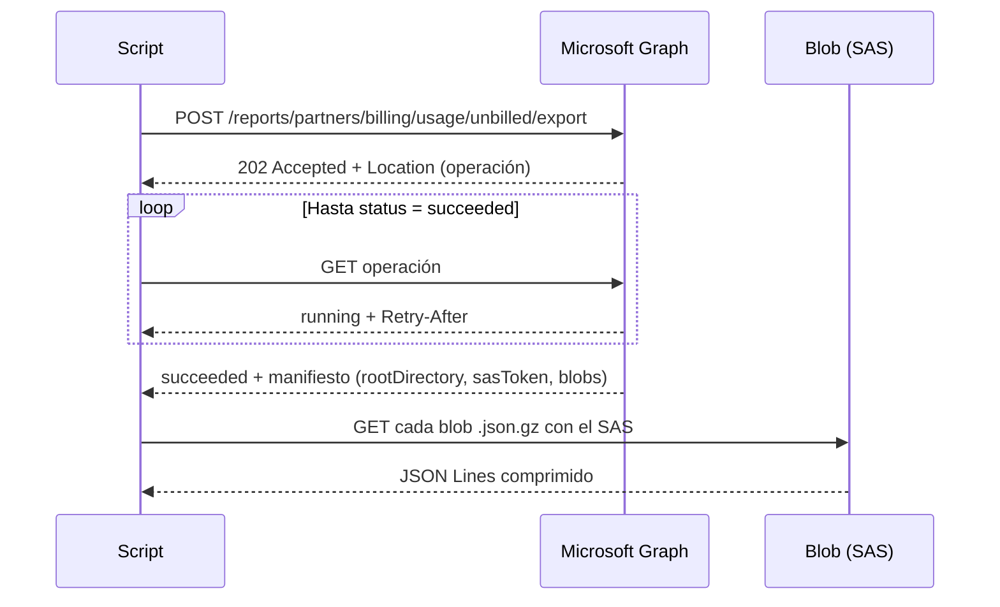

Como partner CSP tienes delante, cada mes, un dato que casi nadie mira con calma: cuánto consume cada cliente en Azure, en qué servicios y cómo cambia. Está en Partner Center, se factura, se concilia… y ahí se queda. Mientras tanto, las conversaciones comerciales se siguen abriendo con un genérico "¿qué tal todo?, ¿necesitáis algo?".

Quería darle la vuelta: que el propio consumo me dijera **a qué cliente llamar primero y de qué hablarle**. Esta es la historia de cómo lo monté en una tarde, con dos scripts de PowerShell, y de todo lo que no funcionó antes de que funcionara.

## La regla que me impuse: señales, no diagnósticos

Antes de escribir una línea dejé claro qué podía y qué no podía sacar de estos datos.

El consumo te dice **qué ha pasado**: un cliente ha empezado a usar un servicio, otro ha duplicado sus máquinas virtuales, un tercero ha dejado de usar una base de datos. Lo que no te dice nunca es **por qué**. Un consumo que cae puede ser una optimización, un proyecto terminado, una migración a otro proveedor o un problema. Un consumo alto no demuestra que el entorno esté mal diseñado ni que haya ahorro posible.

Así que el objetivo no era un informe de "este cliente está haciendo las cosas mal", sino una lista priorizada de **hipótesis para abrir conversaciones**. La confirmación la da siempre el cliente.

## Fase 0: qué quería saber

Partí de seis preguntas, ordenadas por lo útiles que me parecían para vender soporte y servicios:

1. ¿Qué clientes crecen o caen en consumo mes a mes?
2. ¿Qué mezcla de servicios usa cada uno?
3. ¿Hay cambios bruscos que merezcan una revisión?
4. ¿Hay suscripciones sin uso o en riesgo?
5. ¿Quién tiene un consumo alto o una cartera amplia de servicios?
6. ¿Cuadran uso, factura y cargos?

Con eso en la cabeza fui a buscar la fuente de datos. Y ahí empezaron los problemas.

## Fase 1: la API de analítica, o cómo perder una hora con 504

Partner Center tiene una API de analítica de uso de Azure (`/partner/v1/analytics/usage/azure`) que, sobre el papel, era perfecta: permite agrupar por cliente, categoría de medidor y fecha, con agregación mensual.

El primer intento fue filtrar por fecha, tal como muestra la documentación:

```text
filter=usageDate ge cast('2026-05-01', Edm.DateTimeOffset)
```

Respuesta:

```text
HTTP 400: A binary operator with incompatible types was detected.
Found operand types 'Edm.String' and 'Edm.DateTimeOffset' for operator kind 'GreaterThanOrEqual'.
```

El servicio expone `usageDate` como texto, no como fecha, así que el ejemplo documentado no funciona. Lo resolví filtrando los meses en local.

Sin el filtro, la consulta global con agrupación devolvió un **504 Gateway Time-out**. Lógico: le estaba pidiendo al servicio que agregara todo el histórico de todos los clientes en una sola llamada.

Siguiente intento: partir la consulta. Primero la lista de clientes (`/v1/customers`, que funcionó a la primera), y luego una consulta de uso por cliente con `filter=customerTenantId eq '…'`. Añadí reintentos con espera progresiva ante 429 y 5xx, y un registro de errores por cliente para no abortar toda la ejecución por uno solo.

Resultado: **504 también para un único cliente**. Probé incluso sin agrupar en servidor, pidiendo las filas en bruto y sumándolas yo. Mismo 504.

Ahí paré y cambié de pregunta: no "cómo hago que esta API responda", sino "cuál es la vía que Microsoft mantiene hoy para esto".

## Fase 2: la API que sí funciona

La respuesta estaba en la documentación de facturación: la **API v2 de conciliación de uso diario facturado y no facturado**, que ya no vive en el host de Partner Center sino en **Microsoft Graph**. Y su diseño explica por qué la anterior fallaba: es **asíncrona**.

| | API de analítica (v1) | API de conciliación v2 (Graph) |
|---|---|---|
| Modelo | Síncrona: pides y esperas la respuesta | Asíncrona: pides, Microsoft prepara, descargas |
| Volumen | Una consulta larga abierta | Ficheros comprimidos en un blob |
| Datos | Cantidades por medidor | Cantidades **e importes** por línea de uso |
| Resultado en mi caso | 504 constante | Funcionó a la primera |

El flujo tiene tres pasos:



La petición inicial es sencilla:

```powershell
$body = @{
    currencyCode  = $CurrencyCode   # moneda de facturación del partner
    billingPeriod = 'current'       # o 'last'
    attributeSet  = 'full'          # 'basic' no incluye MeterCategory
} | ConvertTo-Json -Compress

$resp = Invoke-WebRequest -Method Post `
    -Uri 'https://graph.microsoft.com/v1.0/reports/partners/billing/usage/unbilled/export' `
    -Headers $graphHeaders -ContentType 'application/json' -Body $body

$operationUri = $resp.Headers['Location'] | Select-Object -First 1
```

Después se consulta la operación respetando la cabecera `Retry-After`, y cuando termina el manifiesto te da la carpeta raíz, un token SAS y la lista de ficheros. Un detalle importante: **el token de Graph no se envía nunca al almacenamiento**. El SAS es la única credencial que necesita el blob, y así debe ser.

Dos cosas a tener en cuenta antes de usarla:

- **Requiere el permiso delegado `PartnerBilling.Read.All` de Microsoft Graph** en la app registrada, con consentimiento de administrador, y un usuario con rol de facturación en Partner Center. El permiso que ya tenía para la API de Partner Center no sirve aquí.
- **El alcance es concreto**: solo comercio nuevo (plan de Azure), y sin reservas, Savings Plan, licencias ni SaaS de Marketplace. La parte "no facturada" cubre el periodo actual y el anterior; para meses más antiguos hay que usar la exportación por factura.

## Fase 3: cientos de miles de líneas sin reventar la memoria

La primera ejecución real devolvió más de 350.000 líneas de uso diario en dos ficheros. Cargarlo todo con `ConvertFrom-Json` habría sido lento y pesado, así que el script lee cada fichero en streaming: descomprime con `GZipStream`, lee línea a línea y parsea cada una con `System.Text.Json`, acumulando directamente por cliente, categoría, unidad y mes.

```powershell
$gz = [System.IO.Compression.GZipStream]::new($fs, [System.IO.Compression.CompressionMode]::Decompress)
$sr = [System.IO.StreamReader]::new($gz, [System.Text.Encoding]::UTF8)
while ($null -ne ($line = $sr.ReadLine())) {
    $doc = [System.Text.Json.JsonDocument]::Parse($line)
    try {
        # UsageDate, CustomerId, MeterCategory, Unit, Quantity, BillingPreTaxTotal...
    }
    finally { $doc.Dispose() }
}
```

La salida es un CSV con una fila por cliente, servicio y mes, con cantidad e **importe sin IVA**. Esto último es lo que cambia el análisis: un +200 % en gigas de almacenamiento puede valer menos que un +10 % en horas de máquina virtual. Medir en unidades te engaña; medir en dinero, no.

## Fase 4: comparar un mes abierto sin engañarte

El primer análisis que me salió era un desastre: **todos los clientes caían a la mitad**. Claro: comparaba septiembre completo con medio octubre.

La solución fue guardar en el CSV el último día con datos de cada mes y proyectar el mes en curso de forma lineal:

```text
Proyección = Importe del mes en curso × días del mes / día hasta el que hay datos
```

Es una aproximación, y lo digo así en el informe: supone consumo uniforme, y un despliegue o un apagado a mitad de mes la distorsiona. Para priorizar conversaciones es suficiente; como previsión de facturación, no.

## Fase 5: de los números a las señales

El segundo script compara el último mes cerrado con el mes en curso proyectado y marca cuatro tipos de señal por cliente y servicio:

| Señal | Condición | Qué suele indicar |
|---|---|---|
| **NUEVO** | Sin consumo el mes anterior y por encima de un umbral ahora | Un proyecto nuevo; la mejor puerta de entrada |
| **CRECE** | Variación ≥ 25 % y diferencia ≥ un importe mínimo | Carga que crece y que alguien tendrá que operar u optimizar |
| **CAE** | Variación ≤ −25 % y diferencia ≥ un importe mínimo | Optimización, fin de proyecto… o riesgo |
| **DESAPARECE** | Consumo relevante antes y cero ahora | Migración, apagado o pérdida; llamada de cuenta |

Los umbrales son parámetros, porque un 30 % de crecimiento sobre 20 € es ruido y sobre 2.000 € no.

Cada señal lleva una hipótesis de conversación según el servicio: máquinas virtuales apuntan a dimensionamiento y reservas; almacenamiento, a ciclo de vida y backup; IA, a gobierno y control de costes de modelos. Los clientes se ordenan por una puntuación que combina el tamaño del cambio en dinero, el peso del cliente y el número de señales.

## Fase 6: lo que salió la primera vez

Sin entrar en clientes ni cifras, sí puedo contar el tipo de cosas que apareció, porque es lo que hace útil la herramienta:

- **Concentración.** Unos pocos clientes concentran buena parte del consumo total. Para dirección, este dato pesa más que cualquier señal individual.
- **Gasto muy concentrado en un servicio.** Un cliente dedica casi la mitad de su consumo a un único servicio de almacenamiento de ficheros de alto rendimiento. Es justo el tipo de partida donde una revisión de dimensionamiento suele tener recorrido.
- **Servicios nuevos de IA y de datos** apareciendo en clientes que no los usaban, que son conversaciones de acompañamiento y gobierno.
- **Caídas bruscas en servicios híbridos gestionados.** No son oportunidades de venta, son **alertas de salud del servicio** que hay que revisar con operaciones antes de que las detecte el cliente.
- **Tenants dados de alta sin consumo**, que piden una conversación de adopción o de limpieza.
- **Ruido que hay que filtrar.** Algunas señales tienen una explicación obvia: un crecimiento de almacenamiento que coincide con una migración en curso, o tenants internos que aparecen como si fueran clientes. Por eso cada señal se valida antes de llamar a nadie.

## Lo que aprendí por el camino

**Cuando una API da timeouts en todas sus variantes, el problema no es tu consulta.** Perdí tiempo afinando filtros y agrupaciones de una API que no iba a responder. Debí buscar antes la vía vigente.

**La documentación no siempre coincide con el servicio.** El filtro de fecha documentado fallaba por tipo de dato. Conviene probar cada supuesto en la primera ejecución real y no darlo por bueno.

**Los mocks te dan falsa confianza si no prueban el flujo completo.** Tuve un bug tonto: una función devolvía la lista de clientes como un único objeto y, al pasarla por la tubería, se perdían todos. Mis pruebas unitarias no lo vieron porque asignaban el resultado a una variable. Desde entonces pruebo el script entero de principio a fin contra una API simulada.

**PowerShell y la configuración regional.** `Export-Csv` escribe los decimales con coma en un Windows en español. El script de análisis tiene que aceptar `1234,57`, `1234.57` y `1.234,57`, o leerá mal los importes sin avisar.

**`Unblock-File` en cada descarga.** Con la directiva `RemoteSigned`, cada versión nueva del script descargada del navegador vuelve a quedar bloqueada. `Get-ChildItem *.ps1 | Unblock-File` después de cada descarga ahorra frustraciones.

## Lo que queda

- **Histórico**: añadir la exportación facturada por factura para comparar más de dos meses y ver tendencias reales, no solo el último salto.
- **Separar lo interno**: un parámetro para excluir tenants propios y una sección aparte para los servicios gestionados, que piden una lectura de retención y no de venta.
- **Afinar las hipótesis**: algunos servicios caen en "revisión general" y las licencias de máquinas virtuales deberían apuntar a Azure Hybrid Benefit.
- **Señales por importe absoluto**: un +10 % en un servicio de 9.000 € al mes es más relevante que muchas señales del 30 % sobre importes pequeños.
- **Programarlo** a cierre de mes y cruzarlo con el CRM: quién lleva cada cuenta, qué tiene contratado y qué proyectos están en marcha.

## Reflexión final

Lo interesante de este ejercicio no fue el código, que al final son dos scripts bastante sencillos. Fue darme cuenta de que el dato llevaba años disponible y que lo que faltaba era **convertirlo en una pregunta concreta para una persona concreta**.

Un informe que dice "este cliente ha empezado a usar servicios de IA y su consumo de máquinas virtuales ha subido un 30 %" no vende nada por sí solo. Pero cambia por completo la llamada: llegas sabiendo qué está pasando en su entorno y puedes preguntar "¿qué estáis montando?" en lugar de "¿necesitáis algo?".

La decisión de qué ofrecer, y si tiene sentido ofrecer algo, sigue siendo humana. Los datos solo te dicen dónde mirar primero.

*¿Trabajas como partner CSP y te peleas con estos mismos datos? Escríbeme y lo comentamos.*
