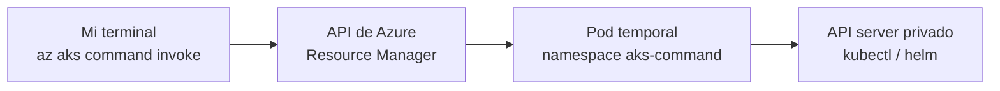

Un clúster AKS privado es una gran idea hasta el momento en que tienes que lanzar un simple `kubectl get pods` y descubres que tu Cloud Shell no ve el API server. Me dio más guerra de la que debería, hasta que encontré `az aks command invoke`. Es una tontería... pero solo cuando ya sabes que existe.

Esta entrada recoge lo que monté para dar acceso a un clúster privado de un cliente: el orden de los comandos, las **dos capas de permisos** que se confunden, un error de identificadores que me costó un rato y las pegas que la propia Microsoft documenta. Todo lo he contrastado con Microsoft Learn, y donde no he podido contrastarlo, lo digo.

---

## Por qué Cloud Shell no llega al clúster

Según la documentación de Microsoft, para acceder a un clúster privado hay que conectarse desde la VNet del clúster, desde una red emparejada o mediante un private endpoint, y eso exige configuración adicional como una VPN o ExpressRoute. Las opciones habituales son estas:

| Opción | Qué exige |
| --- | --- |
| VPN / ExpressRoute | Conectividad de red hasta la VNet del clúster |
| Jumpbox o Azure Virtual Desktop | Una máquina dentro (o conectada) a la red |
| Cloud Shell desplegado en una subred conectada al API server | Desplegar Cloud Shell en tu propia VNet |
| **`az aks command invoke`** | Ninguna conectividad de red: va por la API de Azure |

La última es la que me interesaba: no hay que montar nada de red para una intervención puntual.

---

## Qué hace command invoke por dentro

`command invoke` ejecuta `kubectl` o `helm` en el clúster a través de la API de Azure, sin conectarse directamente al API server. Por debajo, Azure CLI crea un pod temporal `command-<ID>` en el namespace `aks-command`, que solo vive mientras dura el comando.



Conviene conocer sus límites antes de basar nada en él:

| Aspecto | Valor documentado |
| --- | --- |
| Versión mínima de Azure CLI | 2.24.0 |
| Timeout de ARM para programar el pod | 60 segundos |
| Tamaño máximo de la salida | 512 kB |
| Recursos del pod | Requests 200m CPU / 500Mi; límites 500m CPU / 1Gi |
| Salida disponible | Solo `exitCode` y texto |

Y una advertencia de diseño que Microsoft deja por escrito: **no es para acceso programático**. Para llamadas automatizadas recomienda Bastion, VPN o ExpressRoute.

---

## Dos capas de permisos, y la que se olvida

Aquí estaba mi primer error de planteamiento. En mi borrador inicial solo asignaba el rol **Azure Kubernetes Service RBAC Cluster Admin**, pensando que con "admin" ya valía. Pero hay dos capas distintas:

| Capa | Qué controla | Qué lo cubre |
| --- | --- | --- |
| **Plano de control (ARM)** | Poder *invocar* `command invoke` | Las acciones `Microsoft.ContainerService/managedClusters/runcommand/action` y `.../commandResults/read` |
| **Autorización de Kubernetes (Entra ID / Azure RBAC)** | Qué puedes hacer *dentro* del clúster | Los roles *AKS RBAC*; el Cluster Admin da control total sobre todos los recursos del clúster |

Dos comprobaciones en la documentación respaldan esta separación:

- Las dos acciones de arriba son las que, según Microsoft, controlan los permisos para usar `command invoke`, y la solución documentada cuando faltan es asignar el rol **Azure Kubernetes Service Cluster User Role** sobre el clúster.
- La definición del rol RBAC Cluster Admin contiene acciones de lectura, `listClusterUserCredential` y `DataActions` sobre `managedClusters/*`, pero **ninguna de las dos acciones de command invoke**. Por sí solo no te deja invocar.

Antes de asignar nada, merece la pena comprobar qué tipo de RBAC usa el clúster:

```powershell
az aks show -g $rg -n $aks --query aadProfile.enableAzureRbac -o tsv
```

`true` significa Azure RBAC para Kubernetes; `false`, Kubernetes RBAC con sus `RoleBinding`; y vacío, que el clúster no tiene integración con Entra ID.

---

## El script, en PowerShell

Un detalle práctico: los ejemplos de Microsoft están en bash (`\` para continuar línea, `export VARIABLE=...`). En PowerShell la continuación es la comilla invertida y las variables llevan `$`. Si copias y pegas sin traducir, falla.

```powershell
# Variables: sin valores reales en el repositorio ni en la wiki
$sub   = "<nombre-de-la-suscripcion>"
$rg    = "<resource-group-del-aks>"
$aks   = "<nombre-del-cluster>"
$appId = "<application-client-id>"

az account set --subscription $sub

# Resource ID del clúster (scope de los role assignments)
$AKS_ID = az aks show -g $rg -n $aks --query id -o tsv

# Object ID del SERVICE PRINCIPAL (no el de la app registration)
$SP_ID = az ad sp show --id $appId --query id -o tsv

# Capa 1: poder invocar command invoke
az role assignment create `
  --assignee-object-id $SP_ID `
  --assignee-principal-type ServicePrincipal `
  --role "Azure Kubernetes Service Cluster User Role" `
  --scope $AKS_ID

# Capa 2: permisos dentro del clúster
az role assignment create `
  --assignee-object-id $SP_ID `
  --assignee-principal-type ServicePrincipal `
  --role "Azure Kubernetes Service RBAC Cluster Admin" `
  --scope $AKS_ID
```

Si el destinatario es una persona y no una identidad de servicio, el patrón es el mismo con `--assignee-principal-type User` y el object ID del usuario (`az ad user show --id <UPN> --query id -o tsv`).

Para verificar lo asignado y usarlo:

```powershell
az role assignment list --assignee-object-id $SP_ID --scope $AKS_ID -o table

az aks command invoke `
  --resource-group $rg `
  --name $aks `
  --command "kubectl get pods -A"
```

Un matiz más: Microsoft indica que los role assignments nuevos pueden tardar hasta cinco minutos en propagarse. Si recibes un 403 justo después de asignarlos, espera antes de ponerte a depurar.

---

## El error: PrincipalTypeNotSupported

Al lanzar el primer `role assignment create` me devolvió esto:

```
(PrincipalTypeNotSupported) Principals of type Application cannot validly be used in role assignments.
```

El mensaje es literal: el identificador que le pasé correspondía a un objeto de tipo **Application**. Una app registration en Entra ID tiene dos objetos distintos, y las asignaciones de rol solo aceptan el del **service principal**:

| Dato | Dónde sale | ¿Vale en un role assignment? |
| --- | --- | --- |
| Application (client) ID | Overview de la app registration | No como `--assignee-object-id` |
| Object ID de la app registration | Overview de la app registration | **No** (es el objeto Application) |
| Object ID del service principal | `az ad sp show --id <appId> --query id` | **Sí** |

La respuesta oficial de Microsoft Q&A es exactamente esa: el error aparece al pasar el object ID de la app registration, y se arregla pasando el object ID del service principal. Además, la documentación de `az role assignment create` define `--assignee-object-id` como el object ID (o principal ID) del destinatario, y señala que sirve para evitar la consulta a Microsoft Graph.

Un tropiezo menor, pero me pasó: en la pantalla de la app registration conviven **dos GUID distintos** (el client ID y el object ID) y es fácil copiar el equivocado. Si dudas, resuelve siempre por CLI en lugar de copiar del portal.

---

## Cloud Shell: el problema conocido

Si lanzas `command invoke` directamente desde Cloud Shell, puede que no se procese como esperas. Microsoft lo documenta como problema conocido y propone dos salidas:

1. Ejecutar `az login` dentro de Cloud Shell antes de lanzar el comando.
2. Ejecutarlo desde un equipo local o una VM con Azure CLI instalado.

---

## Lo que no hay que olvidar

- **Es acceso puntual, no un canal de automatización.** Si la identidad a la que das acceso es la de un pipeline, recuerda que Microsoft no lo recomienda para acceso programático.
- **Se puede apagar.** Si no lo vas a usar, la propiedad `apiServerAccessProfile.disableRunCommand` desactiva la función en el clúster.
- **Revisa las credenciales de la identidad.** Mientras repasaba la app del pipeline, el portal mostraba un aviso en rojo de que un certificado o secreto había caducado. No tiene que ver con el RBAC, pero es el tipo de cosa que rompe un despliegue un viernes por la tarde. Microsoft recomienda valorar identidades administradas para no depender de credenciales.
- **Mínimo privilegio.** RBAC Cluster Admin es control total del clúster. Si el acceso va a ser permanente, merece la pena acotarlo.

---

## Lo que queda

Me falta probar un **rol personalizado** que incluya solo las dos acciones de `command invoke`, en lugar del Cluster User Role completo. La documentación dice que esas acciones son las que controlan el permiso, así que debería funcionar, pero no lo he validado todavía. Cuando lo pruebe, lo cuento aquí.

---

## Reflexión final

Lo que más me ha enseñado esto es que, en Azure, **"tener permisos sobre el clúster" son al menos dos cosas distintas**: poder llamar a la API de Azure que ejecuta el comando y estar autorizado a hacer algo cuando el comando llega dentro. Y que muchos errores de RBAC no son de permisos, sino de a *quién* se los estás dando: la misma aplicación tiene dos objetos y solo uno vale.

---

## Fuentes

- [Access a private AKS cluster using the command invoke or Run command feature](https://learn.microsoft.com/azure/aks/access-private-cluster)
- [Resolve "az aks command invoke" failures](https://learn.microsoft.com/troubleshoot/azure/azure-kubernetes/connectivity/resolve-az-aks-command-invoke-failures)
- [Access an AKS API server](https://learn.microsoft.com/azure/architecture/security/access-azure-kubernetes-service-cluster-api-server)
- [Cluster authorization concepts in AKS](https://learn.microsoft.com/azure/aks/concepts-cluster-authorization)
- [Azure built-in roles for Containers](https://learn.microsoft.com/azure/role-based-access-control/built-in-roles/containers)
- [Troubleshoot "Forbidden" error when accessing AKS cluster resources](https://learn.microsoft.com/troubleshoot/azure/azure-kubernetes/connectivity/user-cannot-get-cluster-resources)
- [az role assignment create](https://learn.microsoft.com/cli/azure/role/assignment)
- [az ad sp](https://learn.microsoft.com/cli/azure/ad/sp) y [az ad sp credential](https://learn.microsoft.com/cli/azure/ad/sp/credential) (recomendación de identidades administradas)
- [Microsoft Q&A: PrincipalTypeNotSupported al asignar un rol a una app](https://learn.microsoft.com/en-us/answers/questions/1345708/how-to-add-azure-ad-app-as-contributor-to-a-subscr)
- [Configure keyless authentication with Microsoft Entra ID](https://learn.microsoft.com/azure/foundry/foundry-models/how-to/configure-entra-id) (obtención del object ID de un service principal y propagación de roles)

---

*Si tienes preguntas sobre el modelo o quieres los scripts, puedes contactarme en <luisadanmunoz@outlook.com>.*

Revisado el 16 de octubre de 2026.
